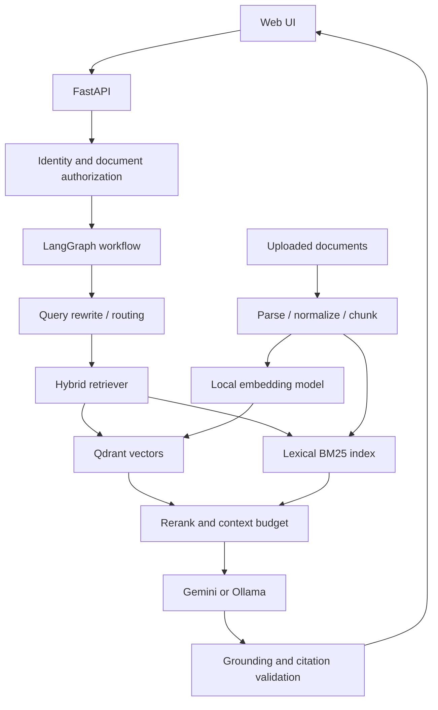

# ZTA KnowledgeAI

**Open-source enterprise knowledge retrieval and grounded AI assistant**  
**Maintained by:** Zain The Analyst (Private) Limited  
**Status:** Milestone 1 implementation committed; runtime validation pending

## Executive overview

ZTA KnowledgeAI is a proposed open-source Retrieval-Augmented Generation (RAG) application for searching organizational documents and producing evidence-backed answers with source citations. It is designed as a reproducible engineering demonstration and a foundation for custom enterprise knowledge systems—not as a certified production-ready product.

### Business problem

Teams spend time searching scattered PDFs, manuals, policies, reports, and knowledge articles. Generic chatbots can produce unsupported answers or expose information outside a user's authorization. KnowledgeAI aims to combine indexed retrieval, citations, access controls, and explicit abstention when evidence is insufficient.

### Intended capabilities

- Upload and index PDF, DOCX, Markdown, TXT, and HTML documents.
- Parse, normalize, deduplicate, chunk, and version source documents.
- Embed text locally and store vectors in Qdrant.
- Combine semantic and lexical retrieval, with optional reranking.
- Orchestrate query rewriting, retrieval, verification, and answer generation with LangGraph.
- Generate answers using Gemini free-tier API or an optional local Ollama provider.
- Return citations referencing document, page/section, and chunk identifiers.
- Evaluate retrieval quality, groundedness, abstention, latency, and resource usage.
- Apply tenant and document-level authorization **before** retrieval and again when resolving citations.

**Milestone 1 source code is now present:** PDF/TXT/MD ingestion, fixed-size chunking, local embeddings, Qdrant Local dense retrieval, optional Gemini generation, a FastAPI interface, and initial API tests. **Not yet implemented:** DOCX/HTML parsing, hybrid BM25 retrieval, reranking, LangGraph workflows, document-level ACLs, verified claim-level citations, production security, and frontend. The implementation has not yet been run or benchmarked on target hardware. See [Getting Started](docs/GETTING_STARTED.md).

## Architecture

See [docs/ARCHITECTURE.md](docs/ARCHITECTURE.md) for the detailed design and data flows.

## Proposed technology stack

| Layer | Default | Alternative / rationale |
|---|---|---|
| API | Python 3.11+, FastAPI | Typed contracts and OpenAPI |
| Orchestration | LangGraph | Explicit state, checkpoints, human review where needed |
| RAG integrations | LangChain | Loaders, splitters, retrievers, provider adapters |
| Generation | Gemini via API | Ollama for fully local/private mode |
| Embeddings | sentence-transformers `all-MiniLM-L6-v2` (384 dimensions) | `intfloat/multilingual-e5-small` for multilingual experiments; separate collection per embedding configuration |
| Vector store | Qdrant local Docker | Local persistent Qdrant client for minimal development |
| Lexical search | rank-bm25 initially | Replace with scalable index as needed |
| Metadata and checkpoints | SQLite initially | PostgreSQL for multi-user deployment |
| Frontend | React + TypeScript | API-first design |
| Evaluation | pytest + curated question sets | Retrieval and generation evaluation scripts |
| Packaging | Docker Compose | Local development without cloud fees |

**Hardware:** Target CPU-only operation on a desktop with 12 GB RAM. Batch indexing, modest corpus sizes, small local embedding models, and no mandatory local LLM. Ollama is optional and performance depends on available CPU/GPU. Gemini free-tier quotas, model availability, data-use terms, and API restrictions must be checked before use; zero cost is not guaranteed at arbitrary volume.

## Security and privacy principles

1. Deny access by default; enforce tenant and document ACL filters before retrieving content.
2. Treat retrieved documents as untrusted input, not instructions to the agent.
3. Never log raw API keys, credentials, or sensitive document text by default.
4. Keep secrets in environment variables; exclude `.env` from version control.
5. Do not upload confidential customer data to an unpaid hosted model without a separately approved data-handling arrangement.
6. Keep source content out of public demonstration repositories; use synthetic or appropriately licensed sample data.
7. Document retention, deletion, reindexing, and citation integrity.

## Quality gates before calling the project production-ready

- Working end-to-end ingestion, retrieval, and cited-answer demo.
- Automated tests for chunk boundaries, embedding dimension consistency, ACL filtering, document deletion, and source attribution.
- Curated benchmark questions with relevant source passages and unanswerable examples.
- Report Recall@k, MRR or nDCG, citation correctness, unsupported-claim rate, abstention behavior, p50/p95 latency, and RAM usage.
- Threat-model review covering prompt injection, cross-tenant retrieval, malicious uploads, and unsafe file parsing.
- Repeatable installation and clean-room setup instructions.

No benchmark scores or customer outcomes are claimed at this stage.

## Planned milestones

1. **Foundation:** repository structure, configuration, CI, local Qdrant, FastAPI health endpoint.
2. **Ingestion:** parsing, metadata, chunking strategies, embedding and versioned indexing.
3. **Retrieval:** semantic and BM25 search, fusion, reranking, ACL filters.
4. **Generation:** LangGraph workflow, Gemini/Ollama adapters, citations, abstention.
5. **Experience:** document management UI, search interface, feedback and audit events.
6. **Validation:** reproducible benchmarks, security tests, developer docs and demo dataset.

## Open-source contribution model

Contributions should include tests, documentation, and reproducible evaluation evidence. Proposed governance documents: `CONTRIBUTING.md`, `CODE_OF_CONDUCT.md`, `SECURITY.md`, and `LICENSE`. Apache-2.0 is the proposed license; the actual license file must be added before describing the repository as licensed under it.

## Ownership and representation

Developed as an open-source engineering initiative of **Zain The Analyst (Private) Limited**. The repository demonstrates proposed engineering capabilities; it does not imply existing deployments, customers, security certifications, or verified performance.
