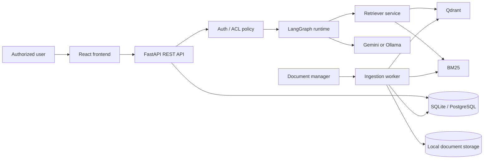
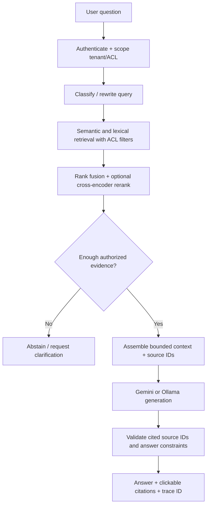

# ZTA KnowledgeAI — Technical Architecture

**Document status:** Proposed design, 19 November 2026  
**Engineering owner:** AI Engineering, Zain The Analyst (Private) Limited

## 1. Architectural goals

Build a reproducible, CPU-friendly, source-grounded enterprise knowledge assistant with provider-independent generation, modular retrieval, measurable quality, and security boundaries. Prioritize correctness and explainability over agent complexity.

## 2. System context



## 3. Ingestion pipeline

1. Accept uploads with configurable size and MIME allowlist; inspect actual file types, not just extensions.
2. Extract text and structural metadata (source ID, tenant ID, ACL, page/heading, parser version, checksum).
3. Normalize text, detect duplicates, preserve page and section offsets, and flag low-quality extraction. OCR is optional and disabled by default for CPU budgets.
4. Compare chunking strategies: recursive character, token-aware, and heading-aware; start with ~400–600 tokens and 10–15% overlap as experimental defaults, not fixed truths.
5. Generate local embeddings in bounded batches; pin model name, revision, dimensionality, and normalization settings.
6. Upsert stable document/chunk IDs to Qdrant and a lexical index; store metadata and indexing status transactionally where possible.
7. Support reindex, delete, and partial-failure recovery; test that deleted documents cannot appear in retrieval or citations.

## 4. Query and answer pipeline



Use reciprocal rank fusion as a baseline; measure whether reranking improves retrieval quality before making it mandatory. LangGraph state contains question, principal, authorized scope, retrieval hits, evidence, model output, citations, errors, and trace ID. Avoid unnecessary tool loops. Set maximum steps, timeouts, and token budgets.

## 5. Data model

- `tenant`: tenant ID, policy configuration.
- `user`: principal ID, tenant membership, roles.
- `document`: immutable ID, owner, checksum, source type, version, status, ACL, timestamps.
- `chunk`: ID, document/version, page/heading/offsets, text hash, embedding model ID, ACL snapshot.
- `query_trace`: request ID, model/retriever versions, timing, redacted diagnostics.
- `feedback`: trace ID, rating, optional correction, consent metadata.

Keep metadata in SQLite for single-user development; use PostgreSQL and explicit row-level policy design for multi-user deployments. Vector payloads must contain tenant ID and allowed document scope. Never trust a tenant ID supplied by the client without server-side validation.

## 6. API contracts (proposed)

- `POST /v1/documents` — upload and enqueue indexing.
- `GET /v1/documents` — list documents visible to principal.
- `DELETE /v1/documents/{id}` — authorized deletion and vector cleanup.
- `POST /v1/query` — answer with citations, retrieval trace ID, and abstention indicator.
- `GET /v1/health` — service health; `GET /v1/ready` — dependency readiness.
- `POST /v1/feedback` — attach feedback to an authorized query trace.

All endpoints require authentication except explicitly configured health checks. Enforce input validation, request limits, and structured errors.

## 7. Model and cost strategy

Use `all-MiniLM-L6-v2` for an English baseline; evaluate multilingual E5 for multilingual documents. Do not mix vector spaces from different models in one collection. Use Gemini only for documents approved for external processing; otherwise use Ollama. Fail closed on provider errors or quota exhaustion—never silently activate billing. API free tiers have changing quotas and terms.

## 8. Evaluation plan

Create synthetic and redistributable document collections with at least three difficulty classes: exact lookup, multi-document synthesis, and unanswerable or conflicting evidence. Track Recall@5, nDCG@10, citation precision, answer faithfulness assessed with human-reviewed samples, abstention precision/recall, p50/p95 latency, memory peak, and ingestion throughput. Publish methodology and raw non-sensitive results; do not fabricate scores.

## 9. Threat model and mitigations

- **Prompt injection:** retrieved content is data, not system instructions; test malicious document examples.
- **Cross-tenant leaks:** pre-filter by server-authorized ACL; add adversarial tests and post-filter citation checks.
- **Malicious files:** limit size, parse in isolated process, pin parser dependencies, scan and reject unsupported content.
- **Data exfiltration:** restrict tool permissions and external requests; never give model unrestricted network access.
- **Stale data:** document versioning, delete propagation, and visible freshness timestamps.
- **Hallucinations:** evidence threshold, source-bound citations, abstention, and evaluation.

## 10. Suggested repository layout

```text
zta-knowledge-ai/
├── README.md
├── LICENSE
├── .env.example
├── .gitignore
├── docker-compose.yml
├── backend/
│   ├── app/api/
│   ├── app/core/
│   ├── app/ingestion/
│   ├── app/retrieval/
│   ├── app/agents/
│   ├── app/providers/
│   └── tests/
├── frontend/
├── evaluation/
│   ├── datasets/
│   └── scripts/
├── docs/
│   ├── ARCHITECTURE.md
│   ├── SECURITY.md
│   └── DEPLOYMENT.md
└── .github/workflows/
```

The tree describes a **target structure**, not files already implemented.

## 11. Implementation sequence and release criteria

- **M0 architecture:** agree on stack, threat model, dataset licensing, and scope.
- **M1 vertical slice:** one document ingested and queried through FastAPI with verified citations.
- **M2 retrieval quality:** hybrid search, chunking comparison, benchmark harness.
- **M3 workflows:** LangGraph, provider abstraction, failures and abstention.
- **M4 enterprise controls:** authentication, ACL tests, document lifecycle, audit.
- **M5 showcase:** usable frontend, demo data, CI, reproducible measurements, security review.

Do not label the project production-ready until authorization tests, privacy review, deployment guidance, and reproducible evaluation pass.
